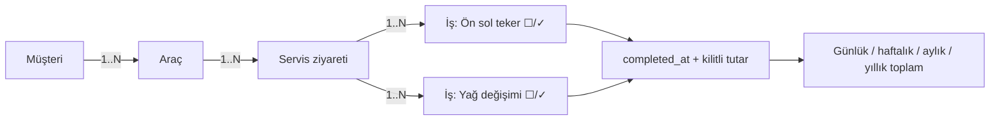

# ServisFlow — Araç Bazlı Servis İş Takibi ve Dönemsel Brüt İş Bedeli Raporlama

> **Durum:** Faz 1 tamamlandı — ekip tarafından onaylandı, öğretim elemanı onayı bekleniyor.  
> **Ders:** Yazılım Kalite Standartları · **Ekip:** 7 kişi · **Sürüm:** v1.1 (31.10.2026)

**ServisFlow**, küçük bir oto serviste her araç için **To-Do uygulaması mantığında yapılacak işler listesi** tutan, işler **✓** ile tamamlandığında tutarlarını tamamlanma gününe yazan ve **günlük / haftalık / aylık / yıllık brüt iş bedelini** raporlayan sade bir web uygulamasıdır.

Proje bilinçli olarak **dar bir MVP** olarak tasarlanmıştır: amaç çok özellik eklemek değil, az sayıda özelliği **ölçülebilir kalite hedefleriyle, test edilmiş ve izlenebilir biçimde** geliştirmektir.

## 🎯 Somut işleyiş

**Örnek (temsili kayıtlar):**

1. `Müşteri ekle` → **Can GPT** kaydı oluşturulur.
2. `Araç ekle` → **34 BJK 321 — Isuzu 10 Long** bu müşteriye bağlanır.
3. Araç servise geldiğinde `Yeni servis ziyareti` açılır; **tarih/saat sistem tarafından otomatik** kaydedilir.
4. Ziyarete yapılacak işler eklenir:

   | ✓ | İş başlığı | Not | Tutar |
   | :---: | :--- | :--- | ---: |
   | ☐ | Ön sol teker | Bilya, keçe, bijon + işçilik | 1.600 TL |
   | ☐ | Yağ değişimi | Motor yağı + filtre | 1.200 TL |

5. İş bitince yanındaki **✓** işaretlenir. Sistem **tamamlanma zamanını** atar, işin tutarını kilitler ve iş **tamamlandığı günün** raporunda **yalnızca bir kez** görünür.
6. Araç başka gün tekrar gelirse **yeni bir servis ziyareti** açılır; önceki ziyaretlerin geçmişi korunur.

## 📅 Dönemsel brüt iş bedeli

Raporlar, **tüm araçlardaki ✓ yapılmış işleri** `completed_at` tarihine göre toplar. Gün sınırları `Europe/Istanbul` takvimine göredir.

| Tamamlanma günü | İş | O günün brüt iş bedeli |
| :--- | :--- | ---: |
| 22 Ekim | Ön sol teker ✓ | 1.600 TL |
| 23 Ekim | Yağ değişimi ✓ | 1.200 TL |
| **İki günü kapsayan hafta** | | **2.800 TL** |

- Açık (✓ yapılmamış) işler rapora girmez.
- ✓ iki kez tıklansa da tutar **ikiye katlanmaz** (idempotent tamamlama).
- Dün açılıp bugün ✓ yapılan iş **bugüne** yazılır.

> **Finansal tanım:** Bu metrik *tamamlanan işlerin brüt bedelidir*; tahsil edilmiş para, net kâr veya muhasebe geliri değildir.

## 📋 Yedi kullanım durumu

| UC | Kullanım durumu | Odak kalite özelliği (ISO/IEC 25010) |
| :--- | :--- | :--- |
| **UC-01** | Kimlik Doğrulama ve Güvenli Oturum Yönetimi | Güvenlik |
| **UC-02** | Müşteri Kaydı, Girdi Doğrulama ve Arama | Fonksiyonel uygunluk |
| **UC-03** | Araç Kaydı, Plaka Normalizasyonu ve Tekillik Denetimi | Veri bütünlüğü |
| **UC-04** | Servis Ziyareti (İş Emri) Açılışı ve Otomatik Zaman Damgalama | İşlemsel doğruluk |
| **UC-05** | Görev Tabanlı İş Listesi Yönetimi (ekle / düzenle / sil) | Kullanılabilirlik, doğruluk |
| **UC-06** | İdempotent Görev Tamamlama (✓) ve Tutar Kilitleme | Güvenilirlik, tutarlılık |
| **UC-07** | Araç Servis Geçmişi ve Zaman Dilimi Duyarlı Dönemsel Raporlama | Doğruluk, kullanılabilirlik |

## 👥 Ekip

> Görev dağılımı **öneridir**; ekipçe onaylandıktan sonra kesinleşecektir.

| Üye | İsim | Proje rolü | Use Case |
| :--- | :--- | :--- | :--- |
| 1 | Ahmet Karavuş | Kimlik Doğrulama ve Güvenlik Geliştiricisi | UC-01 |
| 2 | Alperhan Karşı | İş Analisti / Gereksinim Mühendisi | UC-02 |
| 3 | Mehmet Kenan Dilberoğlu | Scrum Master / Backend | UC-03 |
| 4 | Ilgın Çutok | UI/UX / Dokümantasyon | UC-04 |
| 5 | Kerem Erden | Yazılım Mimarı / DevSecOps | UC-05 |
| 6 | Mehmet Ünsalan | Backend / Beyaz Kutu Testleri | UC-06 |
| 7 | Ahmet Selim Dostabakan | Ekip Lideri / QA ve Test Lideri | UC-07 |

Her üye kendi use case'inin geliştirilmesine ek olarak test, kod inceleme ve DIR beyanına katkıda bulunur.

## 🔄 Veri ilişkileri



**Tablolar:** `User`, `Customer`, `Vehicle`, `ServiceVisit`, `ServiceTask`. Tutarlar **kuruş cinsinden tamsayı** saklanır; zaman damgaları UTC tutulur, raporlar İstanbul saatine çevrilerek hesaplanır.

## 🚫 Kapsam dışı (bilinçli olarak)

Stok/envanter, parça bazlı fiyat satırları, çoklu rol ve yetki matrisi, ödeme/tahsilat, fatura/KDV, çoklu şube, SMS/WhatsApp bildirimleri, mobil uygulama.

## 🛠️ Teknoloji ve kalite araç seti

| Katman | Araç |
| :--- | :--- |
| Dil / arayüz | Python 3.11+ / Streamlit |
| Veri | SQLite / SQLAlchemy |
| Parola güvenliği | Argon2id (`argon2-cffi`) |
| Test / kapsama | pytest / pytest-cov |
| Karmaşıklık | radon (McCabe) |
| Stil / statik analiz | black / flake8 |
| Güvenlik taraması | bandit |
| Karmaşıklık eşiği (CI) | xenon (radon tabanlı) |
| Süreç | GitHub Projects (Scrumban), PR + code review, GitHub Actions (CI) |

**Mimari:** Katmanlı monolit — `ui` (Streamlit ekranları) → `services` (iş kuralları, arayüzden bağımsız ve test edilebilir) → `repository` (veritabanı erişimi).

**Kalite hedefleri (ekip önerisi):** `services` katmanında ≥ %80 satır kapsama; fonksiyon başına McCabe ≤ 10; bandit'te yüksek önemli bulgu = 0; her PR'da en az 1 onay; CI yeşil olmadan `main`'e birleştirme yok.

## 📂 Planlanan dosya düzeni

```text
servisflow/
├── README.md
├── docs/
│   ├── Faz1_Raporu.md
│   └── Sunum_Notlari.md
├── src/servisflow/
│   ├── ui/            # Streamlit ekranları
│   ├── services/      # İş kuralları (UC mantığı)
│   └── repository/    # SQLAlchemy modelleri ve sorgular
├── tests/             # pytest birim ve entegrasyon testleri
├── pyproject.toml     # pytest, coverage ve black ayarları
├── .flake8            # flake8 ayarları
├── requirements.txt / requirements-dev.txt
└── .github/workflows/ # CI: black + flake8 + bandit + radon/xenon + pytest-cov
```

## 🚀 Kurulum

Uygulama kodu Faz 3'te yazılacaktır. Geliştirme ortamı ve kalite kapıları şimdiden kuruludur.

```bash
git clone https://github.com/servisflow/servisflow.git
cd servisflow
python -m venv .venv
source .venv/bin/activate            # Windows: .venv\Scripts\activate
pip install -r requirements.txt -r requirements-dev.txt
```

Kalite kapılarını yerelde çalıştırma (CI'daki adımların aynısı):

```bash
black --check src tests                                  # biçim
flake8 src tests                                         # stil
bandit -r src --severity-level high                      # güvenlik
xenon src --max-absolute B --max-modules B --max-average A   # McCabe ≤ 10
pytest --cov                                             # testler + kapsama ≥ %80
```

Her push ve pull request'te bu adımlar [GitHub Actions](.github/workflows/ci.yml) tarafından otomatik çalıştırılır.

📄 Faz 1 raporu: [`docs/Faz1_Raporu.md`](docs/Faz1_Raporu.md)

## 🗓️ Ders fazları

| Faz | Teslim | Beklenen çıktı |
| :--- | :--- | :--- |
| **1** | Hafta 4 | Ekip, kapsam, teknoloji, ortamlar, süreç, 7 use case, gereksinimler |
| **2** | Hafta 7 | Faz 1 review, test planı, kalite kapıları, risk değerlendirmesi |
| **3** | Hafta 9 | Mimari ve teknik kararlar, kodlama, code review |
| **4** | Hafta 12 | Kara/beyaz kutu, kullanıcı testleri, McCabe, deployment |
| **5** | Hafta 14 | En fazla 20 sayfalık final raporu, DIR, kaynakça ve demo |

## 🤖 DIR ve kaynaklar

- v0.3 (22.10.2026): README ve Faz 1 raporu **ChatGPT** yardımıyla taslak olarak hazırlandı.
- v0.4 (24.10.2026): Ekip kararıyla kapsam daraltıldı (stok, parça satırları, çoklu rol ve audit log çıkarıldı); belgeler **Claude (Anthropic)** yardımıyla yeniden düzenlendi.

İnsan değerlendirmesi ve DIR skorlaması ekipçe yapılacaktır; gerçekleşmemiş testler veya incelemeler yapılmış gibi gösterilmez.

> Demo ve testlerde sentetik müşteri ve plaka verileri kullanılır; gerçek müşteri verileri sisteme girilmez.
