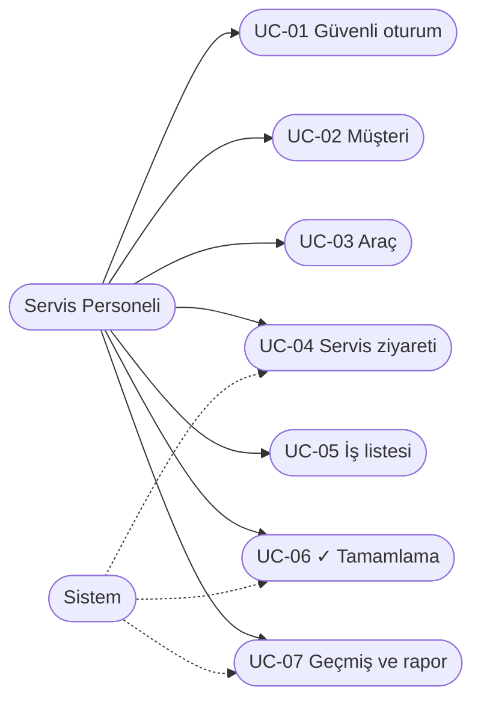
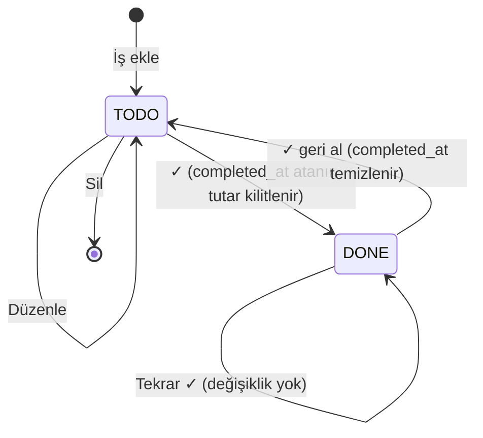

# PROJE RAPORU: FAZ 1 ÇIKTILARI

- **Proje Adı:** ServisFlow — Araç Bazlı Servis İş Takibi ve Dönemsel Brüt İş Bedeli Raporlama
- **Ders:** Yazılım Kalite Standartları
- **Ekip Büyüklüğü:** 7 kişi
- **Doküman Durumu:** v1.1 — ekip tarafından onaylandı, öğretim elemanı onayı bekleniyor
- **Hazırlanma Tarihi:** 22.10.2026 · **Son güncelleme:** 31.10.2026

> **Kapsam kararı (v0.4):** v0.3 taslağındaki stok yönetimi, parça bazlı fiyat satırları, üç rollü yetki matrisi, iş emri durum makinesi ve audit log, ders süresi içinde **her özelliği test edilmiş ve ölçülmüş biçimde teslim edebilmek** amacıyla kapsamdan çıkarılmıştır. Proje, araç bazlı **To-Do tarzı iş takibi** ve **tamamlanma tarihine dayalı dönemsel raporlama** çekirdeğine indirgenmiştir. Bu karar, kalite yönetiminde bilinen *“kapsamı sınırla, derinliği artır”* ilkesine dayanır: daha az özellik, daha yüksek test kapsamı ve daha düşük teknik risk.

---

## 1. Ekiplerin, Görevlerin ve Yapılacak Katkıların Belirlenmesi (Faz 1 - i)

Yönergede ekiplerin **6 veya 7 kişi** olması ve her üyenin **en az bir use case** sorumluluğu üstlenmesi beklenmektedir. Görev dağılımı öneridir; ekip onayıyla kesinleşecektir. Öğrenci numaraları ekipten alınarak tamamlanacaktır.

| Üye | Ad Soyad / Öğrenci No | Proje Rolü | Fazlar Boyunca Somut Katkısı | Sorumlu Use Case |
| :--- | :--- | :--- | :--- | :--- |
| **Üye 1** | **Ahmet Karavuş** / `[No]` | Kimlik Doğrulama ve Güvenlik Geliştiricisi | Giriş modülü, parola özetleme, oturumsuz erişim testleri, bandit bulgularının gözden geçirilmesine destek | **UC-01:** Kimlik Doğrulama ve Güvenli Oturum Yönetimi |
| **Üye 2** | **Alperhan Karşı** / `[No]` | İş Analisti & Gereksinim Mühendisi | FR/NFR ve kabul ölçütlerinin gözden geçirilmesi, izlenebilirlik matrisi, kaynakça | **UC-02:** Müşteri Kaydı, Girdi Doğrulama ve Arama |
| **Üye 3** | **Mehmet Kenan Dilberoğlu** / `[No]` | Scrum Master & Backend Geliştirici | GitHub Projects panosunun takibi, haftalık toplantı notları | **UC-03:** Araç Kaydı, Plaka Normalizasyonu ve Tekillik Denetimi |
| **Üye 4** | **Ilgın Çutok** / `[No]` | UI/UX & Dokümantasyon Sorumlusu | Ekran akışı ve kullanılabilirlik gözden geçirmesi, UAT senaryoları, sunum ve rapor düzeni | **UC-04:** Servis Ziyareti Açılışı ve Otomatik Zaman Damgalama |
| **Üye 5** | **Kerem Erden** / `[No]` | Yazılım Mimarı & DevSecOps | Katmanlı mimari, repo/branch kuralları, CI kurulumu, Faz 2 STRIDE/OWASP risk analizi | **UC-05:** Görev Tabanlı İş Listesi Yönetimi |
| **Üye 6** | **Mehmet Ünsalan** / `[No]` | Backend & Beyaz Kutu Test Uzmanı | Veri modeli, birim/entegrasyon testleri, coverage ve McCabe ölçümleri | **UC-06:** İdempotent Görev Tamamlama ve Tutar Kilitleme |
| **Üye 7** | **Ahmet Selim Dostabakan** / `[No]` | Ekip Lideri & Kalite Güvence (QA) / Test Lideri | Ekip koordinasyonu ve PR onayları, Faz 2 test planı ve kalite kapıları, Faz 4 kara kutu ve UAT testleri, final rapor birleştirme | **UC-07:** Araç Servis Geçmişi ve Dönemsel Raporlama |

**Ortak çalışma ilkesi:** Use case sahibi, o modülün ilk geliştiricisi ve testlerinin sorumlusudur. Katkı yalnızca use case sayısıyla değil, **commit, PR, review ve dokümantasyon kayıtlarıyla** izlenir.

---

## 2. Tech Stack, Araç Seti, Süreç ve Zaman Planı (Faz 1 - ii)

### 2.1. Teknoloji Yığını ve Kalite Araç Seti

| Katman | Teknoloji | Tercih gerekçesi |
| :--- | :--- | :--- |
| Dil / arayüz | Python 3.11+ / Streamlit | Tek dilde hem arayüz hem iş mantığı; ekibin öğrenme maliyeti düşük |
| Veritabanı / ORM | SQLite / SQLAlchemy | Tek şube senaryosu için yeterli; ORM parametreli sorgu ile SQL enjeksiyonunu önler |
| Parola güvenliği | Argon2id (`argon2-cffi`) | OWASP'ın önerdiği modern parola özetleme algoritması |
| Test | pytest / pytest-cov | Birim, entegrasyon, sınır değer testleri ve kapsama ölçümü |
| Karmaşıklık | radon / xenon | McCabe döngüsel karmaşıklık ölçümü; xenon eşik aşıldığında CI'ı durdurur |
| Stil / statik analiz | black / flake8 | PEP 8 uyumlu, tutarlı kod |
| Güvenlik taraması | bandit | Python statik güvenlik analizi |
| Sürüm kontrol | Git / GitHub | PR ve kod incelemesinin izlenebilirliği |
| CI | GitHub Actions | Her PR'da test, kapsama, karmaşıklık ve güvenlik kontrolünün otomatik çalışması |

**Mimari ön kabul:** Katmanlı monolit.

```text
ui/          → Streamlit ekranları (yalnızca gösterim ve girdi alma)
services/    → İş kuralları: tutar doğrulama, ✓ tamamlama, dönem hesabı
repository/  → SQLAlchemy modelleri ve sorgular
```

İş kurallarının arayüzden ayrılması, **kalite açısından kritik kararımızdır**: `services` katmanı Streamlit açılmadan pytest ile test edilebilir; kapsama ve McCabe hedefleri bu katmanda ölçülür.

**Para ve zaman:** Tutarlar **kuruş cinsinden tamsayı** (`1600 TL → 160000`) saklanır; ondalık yuvarlama hatası oluşmaz. Zaman damgaları UTC saklanır, raporlarda `Europe/Istanbul` takvimine çevrilir.

### 2.2. İş Yapış Şekli (Scrumban) ve Kalite Süreci

1. **İş takibi:** GitHub Projects: `Backlog → Ready → In Progress → Review → Done`.
2. **Branch / PR:** Her iş için kısa ömürlü branch (`feature/uc-04-servis-ziyareti`); `main`'e yalnızca PR ile ve en az bir ekip üyesinin onayıyla birleştirilir.
3. **Kalite kapıları (CI):** Testler geçmeli · `services` kapsaması ≥ %80 · McCabe ≤ 10 · bandit yüksek önemli bulgu = 0 · black/flake8 temiz.
4. **Definition of Done:** Kabul kriterleri karşılanmış, testleri yazılmış ve geçmiş, CI yeşil, PR onaylanmış, ilgili doküman ve DIR kaydı güncellenmiş.
5. **İzlenebilirlik:** `FR → UC → GitHub Issue → PR → Test senaryosu` zinciri korunur.
6. **Veri gizliliği:** Demo ve testlerde yalnızca sentetik veri kullanılır.

### 2.3. Geliştirme Ortamı

Faz 1'in “ortamların oluşturulması” çıktısı kapsamında aşağıdaki ortam kurulmuş ve çalıştırılarak doğrulanmıştır:

| Bileşen | Durum |
| :--- | :--- |
| **Kod deposu** | <https://github.com/servisflow/servisflow> (herkese açık, `servisflow` GitHub organizasyonu) |
| **Klasör yapısı** | `src/servisflow/{ui, services, repository}` katmanları, `tests/`, `docs/` |
| **Bağımlılıklar** | `requirements.txt` (uygulama), `requirements-dev.txt` (kalite araçları), sürümler sabitlenmiş |
| **Araç ayarları** | `pyproject.toml` (pytest, coverage ≥ %80, black), `.flake8` |
| **CI** | `.github/workflows/ci.yml`: her push ve PR'da black → flake8 → bandit (yüksek önem) → radon/xenon (McCabe ≤ 10) → pytest + kapsama |
| **Ortam testi** | `tests/test_smoke.py`: paketin ve üç katmanın içe aktarılabildiğini doğrular |
| **İş takibi** | GitHub Projects panosu — `[kurulacak]` |

**Kurulum ve test:** `pip install -r requirements.txt -r requirements-dev.txt` ardından `pytest --cov`. Tüm komutlar README'nin “Kurulum” bölümündedir.

### 2.4. Fazlara Göre Planlanan Çıktılar

| Faz | Not ağırlığı | Çalışma dönemi | Teslim (izlence) | Beklenen çıktılar | Koordinasyon |
| :--- | :---: | :--- | :--- | :--- | :--- |
| **Faz 1** | %5 | Hafta 2–4 | **Hafta 4** | Ekip, roller, teknoloji, ortamlar, kapsam, FR/NFR, 7 use case | Üye 7 + Üye 2 |
| **Faz 2** | %5 | Hafta 5–7 | **Hafta 7** | Faz 1 review, test planı, kalite kapıları, risk değerlendirmesi | Üye 7 + Üye 5 |
| **Faz 3** | %10 | Hafta 8–9 | **Hafta 9** | Mimari kararlar, kodlama, code review | Üye 5–7 + tüm ekip |
| **Faz 4** | %10 | Hafta 10–12 | **Hafta 12** | Kara/beyaz kutu ve kullanıcı testleri, McCabe, deployment | Üye 6–7 + tüm ekip |
| **Faz 5** | — | Hafta 13–14 | **Hafta 14** | Nihai rapor (≤ 20 sayfa), DIR beyanları, demo, öğrenilen dersler | Üye 7 + Üye 4 + tüm ekip |

> Teslim haftaları YAZ401 ders izlencesinden alınmıştır. Faz 3'ün çalışma süresi vize haftalarıyla (Hafta 8–9) çakıştığından kodlama iskeleti Faz 2 sırasında hazırlanacaktır.

---

## 3. Proje Konusu, Kapsamı ve Gereksinimler (Faz 1 - iii)

### 3.1. Problem Tanımı

Küçük oto servislerinde yapılan işler çoğunlukla deftere veya kâğıt iş emirlerine yazılır. Bu durum üç somut soruna yol açar:

1. **Araç geçmişi kaybolur:** Bir aracın daha önce hangi işlemi gördüğü hızlıca bulunamaz.
2. **İş durumu belirsizdir:** Hangi işin bittiği, hangisinin beklediği takip edilemez.
3. **Dönemsel iş hacmi bilinmez:** “Bugün / bu ay ne kadarlık iş tamamlandı?” sorusu elle hesaplanır ve hata içerir; aynı iş iki kez sayılabilir veya yanlış güne yazılabilir.

### 3.2. Çözüm ve Somut Senaryo

**ServisFlow**, her araç ziyareti için To-Do listesi benzeri iş başlıkları tutar; iş ✓ ile tamamlandığında tutarını kilitleyip **tamamlandığı güne** yazar.

**Örnek senaryo (isim, plaka ve tutarlar temsilîdir):**

1. Personel **Can GPT** müşteri kaydını açar.
2. Müşteriye **34 BJK 321 — Isuzu 10 Long** aracını bağlar. Plaka `34 bjk321` gibi yazılsa da sistem `34BJK321` olarak normalize eder.
3. Araç geldiğinde **servis ziyareti** açar; `opened_at` otomatik atanır.
4. Ziyarete **“Ön sol teker — 1.600 TL”** ve **“Yağ değişimi — 1.200 TL”** işlerini ekler (isteğe bağlı not: “bilya, keçe, bijon + işçilik”).
5. Ön sol teker bitince ✓ işaretlenir: `completed_at` atanır, tutar kilitlenir, iş o günün toplamına girer. Yağ değişimi açık kaldığı için rapora girmez.
6. Araç ertesi gün tekrar gelirse yeni ziyaret açılır; eski kayıtlar geçmişte kalır ve yeni günün toplamına eklenmez.

### 3.3. Kapsam

**MVP kapsamı:** Güvenli giriş, müşteri ve araç kaydı, araç için servis ziyareti, ziyarette birden fazla iş başlığı (başlık + not + tutar), ✓ ile idempotent tamamlama ve geri alma, araç geçmişi, günlük/haftalık/aylık/yıllık brüt iş bedeli raporu.

**Kapsam dışı:** Stok ve envanter; parça bazlı fiyat satırları; çoklu rol/yetki matrisi; audit log; ödeme, tahsilat, fatura, KDV; çoklu şube; SMS/WhatsApp bildirimleri; mobil uygulama.

### 3.4. İş Kuralları

| Kod | Kural |
| :--- | :--- |
| **BR-01** | Bir işin tutarı **0'dan büyük** olmalı ve en fazla 1.000.000 TL olabilir; kuruş cinsinden tamsayı saklanır. |
| **BR-02** | ✓ ile tamamlanan işin durumu `DONE` olur, `completed_at` sistemce atanır ve tutar/başlık düzenlemeye kapanır. |
| **BR-03** | Zaten `DONE` olan işe tekrar ✓ isteği gelirse **hiçbir şey değişmez** (idempotent); `completed_at` ve tutar korunur. |
| **BR-04** | ✓ geri alınırsa iş `TODO`'ya döner, `completed_at` temizlenir ve iş rapordan düşer; yeniden ✓ yapılırsa yeni tamamlanma zamanı alır. |
| **BR-05** | Raporlar yalnızca `DONE` işlerin tutarlarını `completed_at` tarihine göre toplar; `opened_at` veya raporun görüntülendiği gün esas alınmaz. |
| **BR-06** | Gün sınırları `Europe/Istanbul` saatine göre belirlenir (23:59:59 → o gün, 00:00:00 → ertesi gün). Hafta Pazartesi başlar. |
| **BR-07** | Plaka; boşluklar kaldırılıp büyük harfe çevrilerek (Türkçe karakter kurallarıyla) normalize edilir ve sistemde tekildir. |
| **BR-08** | `DONE` iş içeren bir ziyaret ve araç silinemez (geçmiş verinin korunması). |

> **Finansal tanım:** Rapor metriği **“tamamlanan işlerin brüt bedeli”**dir; tahsilat, net kâr veya muhasebe geliri değildir.

### 3.5. Fonksiyonel Gereksinimler (FR)

| Kod | Gereksinim | Kabul ölçütü |
| :--- | :--- | :--- |
| **FR-01** | Kullanıcı adı ve parola ile giriş; parolalar Argon2id ile özetlenir; giriş yapılmadan hiçbir ekran açılmaz. | Yanlış parola reddedilir; veritabanında düz metin parola bulunmaz. |
| **FR-02** | Müşteri oluşturma, güncelleme ve ad/telefon ile arama. | “Can GPT” kaydedilir ve “can” aramasıyla bulunur. |
| **FR-03** | Bir müşteriye birden çok araç; normalize edilmiş plaka tekilliği. | `34 bjk 321` ikinci kez eklenmek istendiğinde reddedilir. |
| **FR-04** | Araca her gelişinde yeni servis ziyareti; açılış zamanı otomatik. | Aynı araca farklı günlerde birden çok ziyaret açılabilir. |
| **FR-05** | Ziyarete birden çok iş başlığı (başlık, isteğe bağlı not, tutar) eklenir, `TODO` işler düzenlenip silinebilir. | Ön sol teker ve yağ değişimi ayrı satırlarda listelenir. |
| **FR-06** | İş ✓ ile tamamlanır; tekrar ✓ ikinci kayıt oluşturmaz; ✓ geri alınabilir. | Çift ✓ sonrası günlük toplam değişmez. |
| **FR-07** | Her aracın geçmiş ziyaretleri ve işleri tarih sırasıyla görüntülenir. | Eski ziyaretteki işler yeni ziyaretle karışmaz. |
| **FR-08** | Seçilen gün/hafta/ay/yıl için tüm araçlardaki tamamlanan işlerin brüt toplamı gösterilir. | 22 Ekim: 1.600 TL; 23 Ekim: 1.200 TL; o hafta: 2.800 TL. |

### 3.6. Fonksiyonel Olmayan Gereksinimler (NFR) — ISO/IEC 25010 Eşlemesi

| Kod | ISO/IEC 25010 özelliği | Ölçülebilir hedef | Ölçüm aracı |
| :--- | :--- | :--- | :--- |
| **NFR-01** | Bakım yapılabilirlik | Fonksiyon başına McCabe ≤ 10 (hedef ≤ 7) | `radon cc` |
| **NFR-02** | Bakım yapılabilirlik / test edilebilirlik | `services` katmanında ≥ %80 satır kapsama | `pytest-cov` |
| **NFR-03** | Güvenlik | Parolalar Argon2id; bandit yüksek önemli bulgu = 0 | `bandit`, kod incelemesi |
| **NFR-04** | Güvenilirlik | ✓ işlemi tek veritabanı işleminde (transaction) yapılır; çift istek tek tamamlama üretir | Tekrar istek testi |
| **NFR-05** | Fonksiyonel doğruluk | Para hesabında yuvarlama hatası 0 (tamsayı kuruş) | Birim testleri |
| **NFR-06** | Kullanılabilirlik | Müşteri → araç → ziyaret → iş → ✓ akışı yeni kullanıcı tarafından yardımsız ≤ 3 dakikada tamamlanır | UAT gözlemi |
| **NFR-07** | Gizlilik | Demo ve testlerde yalnız sentetik veri | Veri seti incelemesi |

> Bu eşikler ekibin önerisidir; ders yönergesindeki zorunlu sayısal sınırlar değildir.

### 3.7. Aktörler ve Use Case Diyagramı

- **Servis Personeli:** Müşteri, araç, ziyaret ve iş kayıtlarını yönetir; işleri tamamlar; raporları görüntüler.
- **Sistem:** Zaman damgalarını atar, plakayı normalize eder, tutarları kilitler, dönem toplamlarını hesaplar.



### 3.8. Ayrıntılı Kullanım Durumları

#### UC-01 — Kimlik Doğrulama ve Güvenli Oturum Yönetimi (Üye 1)
| Alan | İçerik |
| :--- | :--- |
| **Aktör** | Servis Personeli |
| **Ön koşul** | Kullanıcı hesabı tanımlı ve aktif. |
| **Ana akış** | Kullanıcı adı ve parola girilir → sistem Argon2id özetini doğrular → oturum açılır → ana ekrana yönlendirilir. Çıkış yapıldığında oturum sonlanır. |
| **Alternatif / hata akışı** | Yanlış kullanıcı adı veya parola için **aynı genel hata mesajı** gösterilir (kullanıcı adı sızdırılmaz). Oturum yokken herhangi bir ekrana erişim giriş ekranına yönlendirir. |
| **Son koşul** | Yetkili oturum açık. |
| **Kalite odağı** | Güvenlik (gizlilik, kimlik doğrulama). |
| **Test** | Doğru/yanlış parola, boş alanlar, veritabanında düz metin parola olmaması, oturumsuz erişim. |

#### UC-02 — Müşteri Kaydı, Girdi Doğrulama ve Arama (Üye 2)
| Alan | İçerik |
| :--- | :--- |
| **Aktör** | Servis Personeli |
| **Ön koşul** | Oturum açık. |
| **Ana akış** | `Müşteri ekle` → ad soyad (zorunlu) ve telefon (isteğe bağlı) girilir → kaydedilir. Müşteri listesinde ad veya telefonla arama yapılır; kayıt güncellenebilir. |
| **Alternatif / hata akışı** | Boş ad, 100 karakteri aşan ad veya geçersiz telefon formatı reddedilir; kullanıcıya alan bazında hata gösterilir. |
| **Son koşul** | Müşteri benzersiz ID ile saklanır. |
| **Kalite odağı** | Fonksiyonel uygunluk, girdi doğrulama. |
| **Test** | Türkçe karakterli isimler (Çağrı, Işıl, Şükrü), büyük/küçük harf duyarsız arama, aynı adlı iki farklı müşteri, sınır değerler (0, 1, 100, 101 karakter). |

#### UC-03 — Araç Kaydı, Plaka Normalizasyonu ve Tekillik Denetimi (Üye 3)
| Alan | İçerik |
| :--- | :--- |
| **Aktör** | Servis Personeli |
| **Ön koşul** | Müşteri kayıtlı. |
| **Ana akış** | Müşteri seçilir → `Araç ekle` → plaka, marka, model girilir → sistem plakayı normalize eder (`34 bjk 321` → `34BJK321`) → kaydedilir. Plaka ile araç aranabilir. |
| **Alternatif / hata akışı** | Normalize edilmiş plaka zaten kayıtlıysa reddedilir; geçersiz plaka formatı reddedilir. |
| **Son koşul** | Araç ilgili müşteri altında listelenir. |
| **Kalite odağı** | Veri bütünlüğü. |
| **Test** | Aynı plakanın farklı yazımları (`34BJK321`, `34 bjk 321`), aynı müşteriye iki araç, geçersiz format, Türkçe karakterli büyük harf dönüşümü. |

#### UC-04 — Servis Ziyareti (İş Emri) Açılışı ve Otomatik Zaman Damgalama (Üye 4)
| Alan | İçerik |
| :--- | :--- |
| **Aktör** | Servis Personeli, Sistem |
| **Ön koşul** | Araç kayıtlı. |
| **Ana akış** | Araç sayfasında `Yeni servis ziyareti` → isteğe bağlı şikâyet/açıklama yazılır → kaydedilir. Sistem `opened_at` zaman damgasını **otomatik** atar; kullanıcı tarih giremez. |
| **Alternatif / hata akışı** | Araç bulunamazsa veya açıklama 500 karakteri aşarsa işlem reddedilir. |
| **Son koşul** | Ziyaret aracın geçmişinde en üstte listelenir; içine iş eklenebilir. |
| **Kalite odağı** | İşlemsel doğruluk, veri bütünlüğü. |
| **Test** | Aynı araca farklı günlerde ayrı ziyaretler, zaman damgasının sistemce atanması (test için sabitlenmiş saat), olmayan araç ID'si. |

#### UC-05 — Görev Tabanlı İş Listesi Yönetimi (Üye 5)
| Alan | İçerik |
| :--- | :--- |
| **Aktör** | Servis Personeli |
| **Ön koşul** | Servis ziyareti mevcut. |
| **Ana akış** | `İş ekle` → başlık (ör. “Ön sol teker”), isteğe bağlı not (ör. “bilya, keçe, bijon + işçilik”) ve tutar girilir → iş `TODO` durumunda listeye eklenir, `created_at` otomatik atanır. `TODO` işler düzenlenebilir veya silinebilir. Ziyaretin açık ve tamamlanmış iş toplamları anlık gösterilir. |
| **Alternatif / hata akışı** | Boş başlık, sıfır/negatif/üst sınırı aşan tutar, metin içeren tutar reddedilir. `DONE` işin düzenlenmesi veya silinmesi reddedilir (BR-02). |
| **Son koşul** | İşler ziyaret altında ayrı satırlar olarak saklanır. |
| **Kalite odağı** | Fonksiyonel doğruluk, kullanılabilirlik. |
| **Test** | Sınır değerler (0, 0,01, 1.000.000, 1.000.000,01 TL), kuruş dönüşümü (`1.600,50` → `160050`), `DONE` işe düzenleme denemesi. |

#### UC-06 — İdempotent Görev Tamamlama (✓) ve Tutar Kilitleme (Üye 6)
| Alan | İçerik |
| :--- | :--- |
| **Aktör** | Servis Personeli, Sistem |
| **Ön koşul** | İş `TODO` durumunda. |
| **Ana akış** | (1) Kullanıcı işin ✓ kutusunu işaretler. (2) Sistem tek bir veritabanı işlemi içinde işi `DONE` yapar, `completed_at` atar ve tutarı kilitler. (3) İş, tamamlandığı günün toplamına dahil olur. |
| **Alternatif akış** | **Tekrar ✓:** İş zaten `DONE` ise hiçbir alan değişmez (idempotent). **Geri alma:** Kullanıcı ✓'yi kaldırırsa iş `TODO`'ya döner, `completed_at` temizlenir, iş rapordan düşer (BR-04). |
| **Son koşul** | Her iş raporda en fazla bir kez ve doğru günde sayılır. |
| **Kalite odağı** | Güvenilirlik, tutarlılık. |
| **Test** | Çift ✓ → tek tamamlama; ✓ → geri al → ✓ akışında yeni `completed_at`; dün açılıp bugün ✓ yapılan iş bugünün toplamında; durum geçiş tablosunun tüm dalları. |

**Durum geçişleri:**



#### UC-07 — Araç Servis Geçmişi ve Zaman Dilimi Duyarlı Dönemsel Raporlama (Üye 7)
| Alan | İçerik |
| :--- | :--- |
| **Aktör** | Servis Personeli, Sistem |
| **Ön koşul** | Oturum açık. |
| **Ana akış** | (1) Plaka ile araç aranır; ziyaretler ve işler tarih sırasıyla listelenir. (2) Rapor ekranında gün/hafta/ay/yıl ve tarih seçilir. (3) Sistem seçilen aralığın İstanbul saatine göre başlangıç-bitişini hesaplar, bu aralıkta `completed_at` değeri olan `DONE` işlerin tutarlarını toplar. (4) Toplam ve işlerin dökümü gösterilir. |
| **Alternatif / hata akışı** | Tamamlanmış iş yoksa `0,00 TL` gösterilir. Geçersiz tarih seçimi açıklayıcı mesajla reddedilir. |
| **Son koşul** | Dünkü tamamlanan iş bugün sayılmaz; dönem raporları tüm araçları kapsar. |
| **Kalite odağı** | Doğruluk, kullanılabilirlik. |
| **Test** | 23:59:59 / 00:00:00 sınırı, hafta (Pazartesi–Pazar) ve ay sınırları, 29 Şubat, yıl geçişi, açık işlerin dışlanması, boş dönem. |

### 3.9. Veri Modeli

| Varlık | Temel alanlar | İlişki |
| :--- | :--- | :--- |
| `User` | `id`, `username`, `password_hash`, `active` | — |
| `Customer` | `id`, `full_name`, `phone`, `created_at` | 1 müşteri → N araç |
| `Vehicle` | `id`, `customer_id`, `plate_normalized` (tekil), `brand`, `model` | 1 araç → N ziyaret |
| `ServiceVisit` | `id`, `vehicle_id`, `opened_at`, `complaint` | 1 ziyaret → N iş |
| `ServiceTask` | `id`, `visit_id`, `title`, `note`, `amount_kurus`, `status` (`TODO`/`DONE`), `created_at`, `completed_at` | ✓ ile tamamlanan iş |

**Rapor sorgusu (kavramsal):**

```sql
SELECT SUM(amount_kurus)
FROM service_task
WHERE status = 'DONE'
  AND completed_at >= :donem_baslangic_utc
  AND completed_at <  :donem_bitis_utc;
```

Toplam bir “sayaç” olarak tutulmaz, **her seferinde sorgudan hesaplanır**. Bu nedenle çift sayım veya ✓ geri alındığında tutarsızlık yapısal olarak oluşamaz.

### 3.10. İzlenebilirlik Matrisi

| UC | Sorumlu | FR | İş kuralı | ISO/IEC 25010 | Test senaryoları |
| :--- | :--- | :--- | :--- | :--- | :--- |
| UC-01 | Üye 1 | FR-01 | — | Güvenlik | TC-01, TC-02 |
| UC-02 | Üye 2 | FR-02 | — | Fonksiyonel uygunluk | TC-03 |
| UC-03 | Üye 3 | FR-03 | BR-07 | Veri bütünlüğü | TC-04 |
| UC-04 | Üye 4 | FR-04 | — | İşlemsel doğruluk | TC-05 |
| UC-05 | Üye 5 | FR-05 | BR-01, BR-02 | Fonksiyonel doğruluk | TC-06, TC-07 |
| UC-06 | Üye 6 | FR-06 | BR-02, BR-03, BR-04 | Güvenilirlik | TC-08, TC-09, TC-10 |
| UC-07 | Üye 7 | FR-07, FR-08 | BR-05, BR-06 | Doğruluk | TC-11, TC-12, TC-13 |

### 3.11. Kritik Test Senaryoları (Plan)

| Test | Teknik | Girdi / koşul | Beklenen |
| :--- | :--- | :--- | :--- |
| TC-01 | Kara kutu | Doğru kullanıcı, yanlış parola | Giriş reddedilir, genel hata mesajı |
| TC-02 | Beyaz kutu | Kayıtlı kullanıcının veritabanı satırı | `password_hash` Argon2id formatında, düz metin yok |
| TC-03 | Denklik sınıfı | “Can GPT” kaydı, “can” araması | Kayıt bulunur |
| TC-04 | Denklik sınıfı | `34BJK321` varken `34 bjk 321` eklenir | Reddedilir |
| TC-05 | Beyaz kutu | Sabitlenmiş saatle ziyaret açılır | `opened_at` = sabit saat |
| TC-06 | Sınır değer | Tutar 0 / 0,01 / 1.000.000 / 1.000.000,01 TL | Red / kabul / kabul / red |
| TC-07 | Durum geçişi | `DONE` işi düzenleme | Reddedilir |
| TC-08 | Durum geçişi | Aynı işe iki kez ✓ | Tek tamamlama, toplam değişmez |
| TC-09 | Durum geçişi | ✓ → geri al → ✓ | Yeni `completed_at`, toplamda bir kez |
| TC-10 | Kara kutu | İş 22 Ekim'de açılır, 23 Ekim'de ✓ | Yalnız 23 Ekim toplamında |
| TC-11 | Kara kutu | 22 Ekim 1.600 TL, 23 Ekim 1.200 TL | Günlük 1.600 / 1.200; hafta 2.800 TL |
| TC-12 | Sınır değer | ✓ 23:59:59 ve 00:00:00 İstanbul saati | Doğru takvim gününe düşer |
| TC-13 | Kara kutu | Açık iş + boş dönem | Açık iş sayılmaz; boş dönem 0,00 TL |

**Test sonuçları henüz mevcut değildir; bunlar planlanan senaryolardır.** Ayrıntılı test planı Faz 2'de hazırlanacaktır.

### 3.12. Ön Risk Listesi (Faz 2'de genişletilecek)

| Risk | Olasılık | Etki | Önlem |
| :--- | :--- | :--- | :--- |
| Saat dilimi hatası nedeniyle işin yanlış güne yazılması | Orta | Yüksek | UTC saklama + İstanbul dönüşümü, TC-12 sınır testleri |
| Çift ✓ ile tutarın iki kez sayılması | Orta | Yüksek | İdempotent tamamlama + toplamın sorgudan hesaplanması |
| Ondalık para yuvarlama hatası | Düşük | Orta | Tamsayı kuruş saklama |
| Parola sızıntısı | Düşük | Yüksek | Argon2id, bandit taraması |
| Ekip içi iş yükü dengesizliği / gecikme | Orta | Orta | Haftalık takip, PR bazlı katkı izleme, erken iskelet kod |
| Streamlit'in yeniden çalıştırma modeli nedeniyle çift form gönderimi | Orta | Orta | İdempotent servis fonksiyonları |

### 3.13. Terim Sözlüğü

| Terim | Anlamı |
| :--- | :--- |
| **Servis ziyareti / iş emri** | Aracın servise bir gelişi; içinde birden fazla iş barındırır. |
| **İş (görev)** | Ziyarette yapılacak tek bir işlem: başlık + tutar + durum. |
| **✓ / tamamlama** | İşin `DONE` durumuna geçmesi. |
| **İdempotent** | Aynı işlemin birden çok kez uygulanmasının sonucu değiştirmemesi. |
| **Brüt iş bedeli** | Tamamlanan işlerin tutarlarının toplamı; tahsilat veya kâr değildir. |
| **Normalizasyon** | Farklı yazımları tek standart biçime getirme (`34 bjk 321` → `34BJK321`). |

---

## 4. Faz 1 İçin DIR Yöntemi ile Yapay Zekâ Kullanım Beyanı

> Beyan, dersin **İSTÜN DIR Rehberi (V2)** ve **Yapay Zekâ Kullanım Beyanı Şablonu** esas alınarak hazırlanmıştır. Puanlar boyut derecelendirmelerine göre ekip tarafından verilir: **DIR = Floor(0,8 × D × I × R)**. Bu bölüm yalnızca **gerçekleşmiş** kullanımı ve **gerçekleşmiş** doğrulamaları anlatır. Yapılmamış işlemler eksiklik olarak belirtilmiştir.

**Görevin YZ kullanım sınırı:** Ders yönergesi analiz, tasarım, test ve dokümantasyon dahil tüm aşamalarda YZ kullanımına izin verir (Göreve Özgü YZ Kullanım Sınırları: teknik dokümantasyon → *Yeşil*). Proje fikri, kapsam kararları ve görev dağılımı ise ekibe aittir ve YZ'ye devredilmemiştir.

### 4.1. İş Paketi 1 — Faz 1 Belgelerinin İlk Taslağı (v0.1–v0.3)

| Alan | İçerik |
| :--- | :--- |
| **Tarih** | 22.10.2026 |
| **YZ aracı** | OpenAI ChatGPT (GPT-6) |
| **İlgili üyeler** | `[Taslağı hazırlayan üye(ler) yazılacak]` |
| **Üretilen çıktı** | README ve Faz 1 raporu taslağı (v0.3) |

**Süreç özeti:** YZ'ye ders yönergesindeki Faz 1 maddeleri, 7 kişilik ekip ve kişi başı en az bir use case koşulu, proje türü (araç servis yönetimi) ve biçim örneği olarak önceki Q-Task deposu verildi. İlk taslağın ardından iki ek turda stok kartı ve minimum stok uyarısı ile günlük/dönemsel brüt iş bedeli istendi. Sonra işlerin To-Do mantığında ✓ ile tamamlanması ve tamamlanma tarihine göre raporlanması tarif edildi; taslak her turda bu girdilere göre revize edildi.

| Boyut | Puan | Kontrol listesi dayanaklı gerekçe |
| :--- | :---: | :--- |
| **D** | 3 | Görev, artifact türü ve biçim örneği tanımlandı (A1, A2); ders ve ekip bağlamı verildi (A3). Ne yapılmaması gerektiğine dair açık kısıt verilmedi, kabul kriterleri yazılı değildi (A4, A6 eksik). Proje fikri ekipte kaldı (A8). |
| **I** | 4 | Üç tur anlamlı yönlendirme yapıldı: stok, dönemsel rapor ve To-Do akışı eklendi (B1, B2). Alternatif model karşılaştırılmadı (B4 eksik). |
| **R** | 3 | Çekirdek ekip toplantısında taslak incelendi; kapsamın ders süresine göre fazla geniş olduğu tespit edilerek stok, çoklu rol, audit log ve parça satırları reddedildi (C5 kısmen). Kaynakların birincil kaynaktan doğrulanması bu sürümde yapılmadı (C1 eksik). Kod yok; C3 uygulanamaz. |

**Skor:** D = 3, I = 4, R = 3 → DIR = Floor(0,8 × 36) = **28** → **Bant 2 (Yüzeysel ve Temel Sorumluluk)**. Bantın düşük kalmasının nedeni, ilk taslakta negatif yönergelerin ve kabul kriterlerinin tanımlanmamış olmasıdır. Bu eksiklik İş Paketi 2'de giderilmiştir.

### 4.2. İş Paketi 2 — Kapsam Daraltma Revizyonu ve Faz 1 v1.0 (v0.4–v1.0)

| Alan | İçerik |
| :--- | :--- |
| **Tarih** | 24.10.2026 – 31.10.2026 |
| **YZ aracı** | Anthropic Claude (Claude Code, ajan tabanlı; proje klasörü ve GitHub üzerinde dosya düzenleme yetkisiyle) |
| **İlgili üyeler** | Ahmet Selim Dostabakan (yönlendirme); Ahmet Selim Dostabakan, Kerem Erden, Mehmet Ünsalan (ekip toplantısında gözden geçirme ve onay) |
| **Üretilen çıktı** | README ve Faz 1 raporu v0.4–v1.0, sunum notları, GitHub deposu, geliştirme ortamı iskeleti |

**Süreç özeti:** YZ'ye v0.3 belgeleri, ekip kararı olan daraltılmış kapsam (stok yok, yalnızca araç bazlı To-Do takibi, çok dar MVP), sınıfta sözlü sunum yapılacağı bilgisi ve use case adlarının içerikle tutarlı biçimde açıklayıcı olması beklentisi verildi. YZ'nin ürettiği revizyon; use case dağılımı, iş kuralları, test senaryoları ve kaynaklar açısından turlar halinde yeniden yönlendirildi. Depo görünürlüğü, öğrenci numaralarının nerede tutulacağı ve ekip liderliği gibi kararlar insan tarafından verildi; YZ'nin bu konudaki önerileri seçenek olarak sunuldu.

| Boyut | Puan | Kontrol listesi dayanaklı gerekçe |
| :--- | :---: | :--- |
| **D** | 4 | Görev, çıktı biçimi, hedef kitle (hoca ve sınıf) ve sunum bağlamı verildi (A1, A2, A3). Negatif yönergeler açıkça belirtildi: stok yok, MVP çok dar tutulacak, yapılmamış test yapılmış gibi gösterilmeyecek, ekip içi plan herkese açık depoya konmayacak (A4). Dosyalara ve GitHub'a doğrudan erişebilen bir ajan aracı bilinçli olarak seçildi (A5). Kapsam, use case dağılımı ve depo görünürlüğü kararları insanda kaldı (A8). Ajanın uzak depo ayarını değiştirme denemesi izin sistemi tarafından durduruldu (A9). **Sınırlılık:** Ekip üyelerinin öğrenci numaraları, teslim belgesine işlenmesi için YZ aracına iletildi. Numaralar herkese açık depoya konmadı, ancak A7 açısından bu bir eksikliktir. Sonraki fazlarda kişisel veri YZ'ye verilmeyecek, teslim belgesine elle eklenecektir. |
| **I** | 4 | İlk revizyon incelendi ve çok turlu yönlendirme yapıldı: kapsam daraltma, use case adları, use case'lerin yeniden dağıtımı, mesaj biçimi (B1, B2). YZ'nin depoyu gizli yapma önerisi değerlendirilip herkese açık seçildi. Öğrenci numaralarının depoya konmasına yönelik akış durdurularak ayrı teslim kopyasına yönlendirildi (B3). Kalıcı işlemler insan onayına bağlandı: depo görünürlüğü, push, liderlik değişikliği (B6). Farklı modeller yan yana karşılaştırılmadı (B4 eksik). |
| **R** | 3 | Kapsam, iş kuralları ve kalite hedefleri ekip toplantısında incelenip onaylandı (C5). Ajanın “gönderildi” bildirimleri GitHub'daki commit ve dosya listesiyle karşılaştırıldı; depo taşıma sonrası adres değişikliği fark edildi (C4, C7). **Eksik:** ISO/IEC standartları, OWASP ve McCabe kaynakları ekip tarafından birincil kaynağından henüz açılıp doğrulanmadı (C1). İş kuralları gerçek bir servis çalışanıyla teyit edilmedi. Kod yok; C3 uygulanamaz. |

**Skor:** D = 4, I = 4, R = 3 → DIR = Floor(0,8 × 48) = **38** → **Bant 3 (Etkin ve Dengeli Yönetişim)**.

**R'yi 4'e çıkarmak için planlanan işlemler (Faz 2 review kapsamında):** Kaynakçadaki her standart ve makale birincil kaynağından açılıp künyesi kontrol edilecek. BR-01 – BR-08 kuralları bir servis çalışanına okutulacak. Her üye kendi use case'ini sözlü olarak savunabilecek düzeyde inceleyecek (C6). Bu işlemler gerçekleşirse skor D = 4, I = 4, R = 4 → **51** olarak güncellenecektir.

### 4.3. Özet Beyan Tablosu

| Üretilen artifact & YZ aracı | Kullanım amacı | İnsan müdahalesi ve düzeltme | Doğrulama yöntemi |
| :--- | :--- | :--- | :--- |
| README + Faz 1 v0.3 / ChatGPT | Doküman taslağı | Stok, dönemsel rapor ve To-Do akışı eklettirildi; sonra geniş kapsam ekipçe reddedildi | Ekip toplantısında kapsam incelemesi |
| Faz 1 v0.4–v1.0, sunum notları / Claude Code | Kapsam daraltma revizyonu, gereksinim ve test senaryosu yapılandırma | Use case dağılımı ve adları insan kararıyla değiştirildi; kişisel veri depodan uzak tutuldu | Ekip onayı; GitHub üzerinde commit kontrolü |
| Geliştirme ortamı iskeleti / Claude Code | CI ve araç yapılandırması | Kalite eşikleri (kapsama, McCabe, bandit) ekip hedeflerinden alındı | Araçlar yerelde çalıştırıldı; CI sonucu GitHub Actions'ta kontrol edildi |

> **Öğrenme soruları ve taahhütname:** Rehber gereği her üye kendi adına öğrenme sorularını yanıtlar ve taahhütnameyi imzalar. Bunlar teslim belgesine kişi bazında eklenecektir.

### 4.4. Ekipçe Yapılması Gereken Doğrulamalar

- [x] Proje adı ve daraltılmış kapsam ekip toplantısında onaylandı.
- [ ] Proje adı ve daraltılmış kapsam ders hocasıyla kesinleştirildi.
- [x] Use case atamaları onaylandı.
- [ ] Yedi üyenin öğrenci numaraları toplandı (6/7).
- [x] İş kuralları (BR-01 – BR-08) ekipçe okundu ve onaylandı.
- [x] Kalite hedefleri (kapsama, McCabe, bandit) kabul edildi.
- [x] GitHub reposu oluşturuldu: <https://github.com/servisflow/servisflow>
- [ ] GitHub Projects panosu oluşturuldu.
- [x] Geliştirme ortamı ve CI iskeleti kuruldu (Bölüm 2.3).
- [x] DIR puanları dersin resmi yöntemine (İSTÜN DIR Rehberi V2) göre verildi.
- [ ] Her üye DIR öğrenme sorularını yanıtladı ve taahhütnameyi imzaladı.

---

## 5. Kaynaklar (Faz 1)

1. **Yazılım Kalite Standartları — Grup Projesi**, öğretim elemanı yönergesi (ders materyali).
2. **ISO/IEC 25010:2023**, *Systems and software engineering — Systems and software Quality Requirements and Evaluation (SQuaRE) — Product quality model*. NFR sınıflandırmasında kullanılmıştır.
3. **ISO/IEC/IEEE 29148:2018**, *Requirements engineering*. FR/NFR ve kabul ölçütü yazımında yol gösterici olarak kullanılmıştır.
4. **ISO/IEC/IEEE 29119**, *Software testing*. Faz 2 test planı için referans alınacaktır.
5. **OWASP Password Storage Cheat Sheet**, parola özetleme yöntemi seçimi (Argon2id).
6. **McCabe, T. J. (1976).** *A Complexity Measure.* IEEE Transactions on Software Engineering, SE-2(4), 308–320.
7. **Q-Task: Kurumsal Görev, Kalite ve SLA Takip Sistemi**, biçim örneği, [GitHub](https://github.com/alperhank/q-task-quality-system) (erişim: 22.10.2026).
8. **OpenAI ChatGPT** (22.10.2026) ve **Anthropic Claude — Claude Code** (24–31.10.2026); kullanım Bölüm 4'te beyan edilmiştir.
9. **Bağrıyanık, S.** *Yükseköğretimde Sorumlu Yapay Zekâ Kullanımına Dair Bir Öneri: DIR Çerçevesi* (İSTÜN DIR Rehberi V2) ve *Yapay Zekâ Kullanım Beyanı Şablonu*, ders materyali, İstanbul Sağlık ve Teknoloji Üniversitesi, 2026.
10. **YAZ401 Yazılım Kalite Standartları Ders İzlencesi**, İstanbul Sağlık ve Teknoloji Üniversitesi, 2026–2027 Güz. Teslim haftaları buradan alınmıştır.

---

**Doküman notu:** Bu içerik **Faz 1 çıktısıdır**. Faz 2 test planı ve risk analizi, Faz 3 mimari/kod kanıtları ve Faz 4 ölçüm sonuçları henüz üretilmediğinden sonuç olarak sunulmamıştır. Final raporu tüm fazları ve kaynakçayı kapsayacak şekilde **20 sayfayı aşmayacaktır**.
